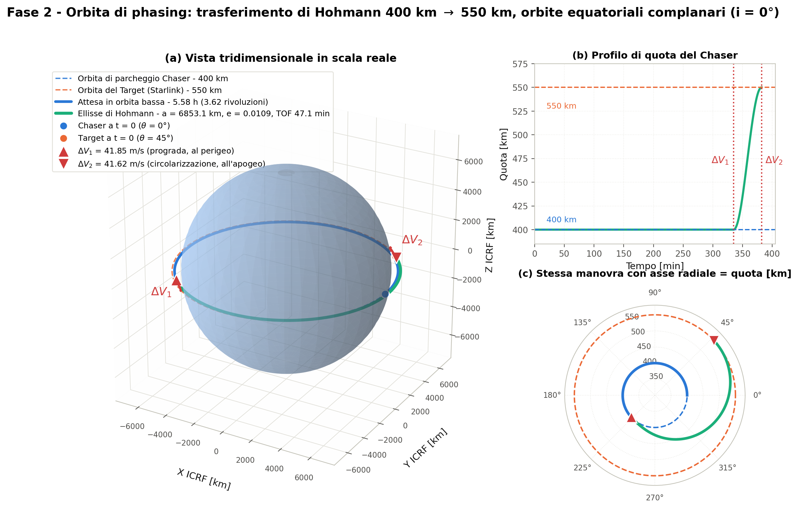
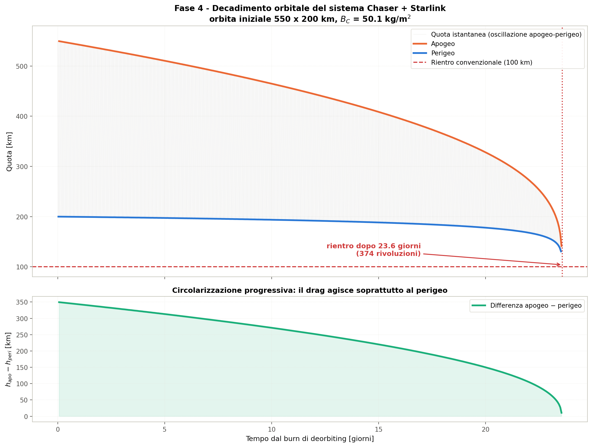

# Active Debris Removal of a Starlink Satellite in LEO

**Bachelor's thesis in Aerospace Engineering, University of Padova**

A Python and FreeFlyer simulation of an Active Debris Removal (ADR) mission. A 400 kg chaser
intercepts a decommissioned 295 kg Starlink satellite at 550 km, captures it and lowers the
perigee to 200 km, so that atmospheric drag brings both down in about **24 days** instead of the
**~6 years** the target would take on its own.


*Phasing: Hohmann transfer from the 400 km parking orbit to the target at 550 km. Figure labels are in Italian, as in the thesis.*

## Mission scenario

| Parameter | Value |
|---|---|
| Chaser | 400 kg wet mass, I<sub>sp</sub> = 300 s, circular parking orbit at 400 km |
| Target | Decommissioned Starlink, 295 kg, circular orbit at 550 km |
| Initial geometry | Coplanar equatorial orbits, target 45° ahead of the chaser |
| Re-entry ellipse | 550 × 200 km |
| Drag | C<sub>D</sub> = 2.2, frontal area 4 m² (target) + 2 m² (chaser) |

The phase numbering follows the thesis chapters.

| Phase | What happens | Script |
|---|---|---|
| 2 – Phasing | The chaser waits until the phase angle matches the Hohmann lead angle, then performs two burns | `src/phase2_phasing.py` |
| 3 – Deorbit burn | After the capture, a retrograde burn at 550 km lowers the perigee of the stack to 200 km | `src/phase3_deorbit.py` |
| 4 – Atmospheric decay | Numerical propagation with drag until the stack reaches 100 km | `src/phase4_decay.py` |

## Results

| Quantity | Value |
|---|---|
| Waiting time in the parking orbit | 5 h 35 min |
| Transfer time (ΔV<sub>1</sub> → ΔV<sub>2</sub>) | 47.1 min |
| ΔV<sub>1</sub> / ΔV<sub>2</sub> (phasing) | 41.85 / 41.62 m/s |
| ΔV<sub>3</sub> (deorbit burn) | 98.93 m/s |
| **Total ΔV** | **182.4 m/s** |
| Propellant | 33.8 kg (11.2 kg phasing + 22.6 kg deorbit) |
| Ballistic coefficient of the stack | 50.1 kg/m² |
| **Time to re-entry (100 km)** | **23.6 days, 374 revolutions** |



## Validation against FreeFlyer

The same mission is modelled in FreeFlyer (`freeflyer/adr_mission.MissionPlan`), using the
ΔVs computed in Python as manoeuvre inputs. FreeFlyer then propagates the trajectory on its own,
so the comparison checks the geometry and the re-entry independently.

| Quantity | Python | FreeFlyer |
|---|---|---|
| Transfer time ΔV<sub>1</sub> → ΔV<sub>2</sub> | 2823.03 s | 2822.97 s |
| Chaser–target distance at ΔV<sub>2</sub> | 0 km (ideal) | 0.21 km |
| Perigee after ΔV<sub>3</sub> | 200.00 km | 199.99 km |
| Time to re-entry (100 km) | 23.58 days | 20.95 days |

The two simulations use different atmosphere models (US Standard Atmosphere 1976 in Python,
Jacchia-Roberts in FreeFlyer); the re-entry time differs by 11%. The full comparison is in
[`figures/09_validazione_freeflyer.png`](figures/09_validazione_freeflyer.png).

## Model assumptions

- Point-mass Earth (no J2), coplanar circular equatorial orbits
- Impulsive burns with constant specific impulse
- Capture and docking are not modelled: after the rendezvous, chaser and target are a single rigid body
- Exponential US-76 atmosphere co-rotating with the Earth, constant drag coefficient and frontal area, no attitude dynamics
- Equations of motion integrated with `scipy.integrate.solve_ivp` (DOP853), stopped by a re-entry event at 100 km

## Repository structure

```
src/
  constants.py                     mission parameters and physical constants (edit here)
  phase2_phasing.py                Hohmann phasing: waiting time, ΔV1, ΔV2, propellant
  phase3_deorbit.py                deorbit burn, mass budget, ballistic coefficient
  phase4_decay.py                  drag propagation down to re-entry
  phase5_figures.py                thesis figures 01-10
  phase6_presentation_figures.py   presentation figures 11-18
freeflyer/
  adr_mission.MissionPlan          FreeFlyer mission (needs a FreeFlyer licence to run)
  Burn1-3.txt, *.Report, *.txt     FreeFlyer outputs used for the validation
  phasing_params.txt               values copied into the FreeFlyer mission
figures/                           all figures (labels in Italian)
```

## How to run

```bash
pip install -r requirements.txt
cd src
python phase3_deorbit.py                 # phasing + deorbit: ΔV and propellant budget
python phase4_decay.py                   # re-entry propagation (~10 s)
python phase5_figures.py                 # figures 01-10 (~1 min)
python phase6_presentation_figures.py    # figures 11-18 (~1 min)
```

To try a different scenario (altitudes, masses, I<sub>sp</sub>, drag areas), change
`src/constants.py` and run the scripts again. FreeFlyer is only needed to rerun the mission plan:
its outputs are already in `freeflyer/`.

## References

- H. D. Curtis, *Orbital Mechanics for Engineering Students* (atmosphere table in `phase4_decay.py`)
- L. Savioli, *Analysis of innovative scenarios and key technologies to perform active debris removal with satellite modules*, PhD thesis, University of Padova (CISAS), 2015
- A. M. Masserini, *Design and optimisation of an active debris removal service for large satellite constellations*, MSc thesis, Politecnico di Milano, 2020
- C. Steimle, J. Marie, S. Woicke, L. Metrailler, *ClearSpace-1 In-Orbit Demonstration Mission*, SpaceOps 2025, Montreal
- M. Ballard, G. Song, T. Zhu, *Chain Reactions in Space: Analyzing the Impact of Satellite Collisions and Debris Accumulation*, arXiv:2512.22429, 2025
- V. Ray et al., *The impact of space weather on very low Earth orbit (VLEO) satellites*, University of Colorado Boulder

## Author

**Mattia Mingolla** – BSc in Aerospace Engineering, University of Padova
[LinkedIn](https://www.linkedin.com/in/mattia-mingolla/) · mattiamingollawork@gmail.com

Thesis (in Italian): *Simulazione di Active Debris Removal (ADR) in orbita LEO: Intercettazione e Deorbiting di un satellite Starlink*
